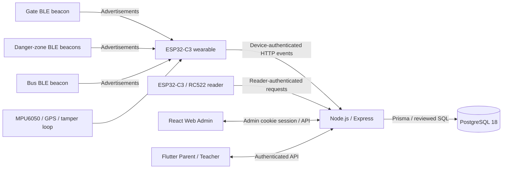

# ChildGuard V2

ChildGuard V2 is an IoT child-monitoring prototype that connects ESP32-C3 wearables, BLE beacons and an RFID attendance reader to a Node.js backend, PostgreSQL database, React Web Admin and Flutter Parent/Teacher app. It combines embedded sensing with authenticated event processing and role-based workflows for daycare monitoring.

This repository is a reviewed source copy prepared for an IoT/Embedded Systems portfolio. It has not been deployed from this copy. Database migration reconciliation and hardware acceptance remain open; see [publication blockers](docs/PUBLICATION_BLOCKERS.md) and [validation results](docs/VALIDATION.md).

## Capabilities

| Area | Implementation |
| --- | --- |
| Wearable | ESP32-C3 with MPU6050 motion sensing, UART GPS, BLE scanning, Wi-Fi telemetry and a physical tamper loop |
| Gate monitoring | BLE proximity evidence initiates an attendance workflow; teacher confirmation establishes attendance |
| Danger zones | Separate BLE zone identities, filtered RSSI, hysteresis and fresh FAR-to-NEAR evidence; eligibility checked by the backend |
| RFID attendance | Separate ESP32-C3/RC522 reader with reader authentication, card enrollment and duplicate-presentation suppression |
| GPS | Timestamped location evidence and freshness checks; prototype geofence support depends on reviewed database storage |
| Activity | Sensor coverage checks, MAD movement summaries and personalized history/baseline analysis; this is not a medical assessment |
| Tamper | Debounced continuity loop, independent sampling task, persistent transition journal and authenticated opening/restoration events |
| Bus transport | Separate BLE bus beacon and opt-in transport observation prototype; BLE presence does not prove boarding or passenger identity |
| Backend | Express APIs, validation, device tokens, role/center authorization, admin cookie sessions and monitoring updates |
| Web Admin | React/Vite dashboard for children, users, wearables, beacons, attendance, alerts and monitoring |
| Mobile | Flutter Parent/Teacher workflows for linked children, attendance, activity, notifications and pickup requests |

## Architecture



The backend resolves each wearable to its authorized assignment instead of trusting a child identity sent by a device. Event IDs support retry deduplication. Attendance confirmation and fresh proximity evidence determine danger eligibility. Sensor and network uncertainty are surfaced rather than treated as a safe condition. See [architecture and engineering decisions](docs/ARCHITECTURE.md).

## Repository layout

```text
firmware/       Wearable, Gate/Danger Zone, bus beacon, RFID reader and host tests
backend/        Express source, tests, Prisma schema, migrations and review SQL
web_front/      React Web Admin, assets and tests
App/            Flutter source, platform projects, assets and tests
scripts/        Supporting PowerShell/SQL tools; historical deployment guards retained
V2_Planning/    Minimal historical artifacts required by regression tests
docs/           Setup, hardware, architecture, security and publication review
```

## Getting started

Use Node.js 22.12 or newer, a Flutter SDK satisfying Dart `^3.13.2`, and Python 3 for firmware host checks. Native firmware state-machine tests require a C++17 compiler. Recorded firmware tooling uses ESP32 Arduino core 3.2.1 and NimBLE-Arduino 2.5.1; full linked compilation of this copy remains unverified.

1. Read [setup](docs/SETUP.md), [database reconciliation](docs/DATABASE.md) and [hardware wiring](docs/HARDWARE.md).
2. Install locked JavaScript dependencies with `npm ci` inside `backend` and `web_front`. Use `flutter pub get` inside `App`.
3. Configure private values from `backend/.env.example`, `web_front/.env.example`, each firmware `secrets.example.h`, and `App/config.example.json`. Examples contain placeholders only.
4. Run the isolated checks described in [testing](docs/TESTING.md). The default backend test command includes database integration suites; use the supplied isolated runner for source review.
5. Start database-backed services only after the migration blockers have been resolved in a separately approved disposable environment. An empty database cannot currently be promised to bootstrap successfully from the retained migration chain.

## Limitations

This is a research and demonstration prototype, not a certified child-safety or emergency-dispatch product. BLE RSSI is environment-dependent, GPS can be stale or unavailable, and offline queues are bounded. The wearable currently uses HTTP telemetry and requires a reviewed secure transport design before deployment. Mobile background notifications and automatic emergency dispatch are unavailable. Some historical deployment checks intentionally depend on the original workspace and frozen generated-client artifacts. PostgreSQL 18 runtime compatibility, a complete fresh database setup, physical timing and complete firmware builds need independent verification.

No live credentials, database backups or operational child records are intended for this copy. Demo data is synthetic. Review [security findings](docs/SECURITY_REVIEW.md), the [public-file manifest](docs/public-files.csv), [excluded-file decisions](docs/EXCLUDED_FILES.md) and [changes from the source](docs/CHANGES.md) before approving publication. No license has been selected; ownership and third-party asset rights need review.

Git has not been initialized. Follow [GitHub upload instructions](docs/GITHUB_UPLOAD.md) only after approving the reviewed contents.
